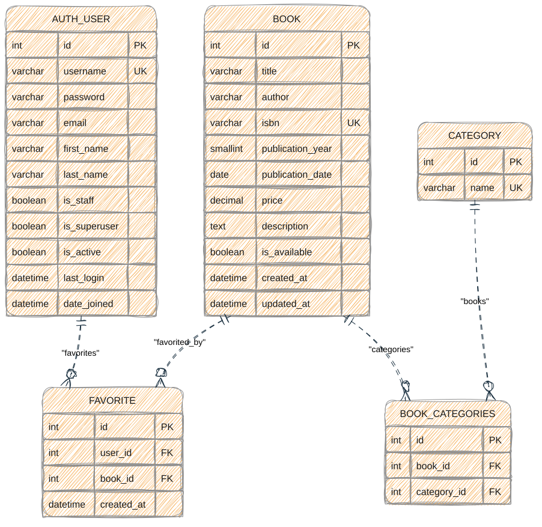

# Django Library Management

A Django web application for managing a library catalog. It supports book and category management, search and filtering, staff-only editing, user registration and login, and private per-user favorites.

Repository: <https://github.com/amirrezaparvaneh/django-library-management>

## Contents

- [Features](#features)
- [Tech stack](#tech-stack)
- [Getting started](#getting-started)
- [Routes](#routes)
- [Access control](#access-control)
- [Data model](#data-model)
- [Testing](#testing)
- [Configuration](#configuration)
- [License](#license)

## Features

- **Books:** create, view, edit, and delete books.
- **Search:** case-insensitive partial matching on title and author.
- **Filters:** availability, category, price range, and publication-date range.
- **Bulk delete:** delete all books that match the current filters. At least one filter is required.
- **Categories:** list and create categories. Books and categories have a many-to-many relationship.
- **Accounts:** registration, login, and logout (logout is POST-only).
- **Favorites:** each user has a private list of favorite books. Duplicate favorites are prevented.
- **Security:** CSRF protection on all state-changing requests.
- **Styling:** responsive layout served from `static/books/app.css`.

## Tech stack

| Component | Version or configuration |
| --- | --- |
| Python | 3.14 or later |
| Django | 6.0.8 |
| Database | SQLite (default for development) |
| Testing | Django test runner (`python manage.py test`) |

Exact dependency versions are pinned in [`requirements.txt`](requirements.txt).

## Getting started

1. Clone the repository and enter its directory:

   ```bash
   git clone https://github.com/amirrezaparvaneh/django-library-management.git
   cd django-library-management
   ```

2. Create and activate a virtual environment:

   ```bash
   python3 -m venv .venv
   source .venv/bin/activate
   ```

3. Install the dependencies:

   ```bash
   pip install -r requirements.txt
   ```

4. Apply the migrations:

   ```bash
   python manage.py migrate
   ```

5. Create a staff account. Only staff can add, edit, or delete books and create categories:

   ```bash
   python manage.py createsuperuser
   ```

6. Start the development server:

   ```bash
   python manage.py runserver
   ```

   Open <http://127.0.0.1:8000/> in your browser.

## Routes

| Route | Description |
| --- | --- |
| `/` or `/books/` | Book list with search and filters |
| `/books/add/` | Add a book (staff) |
| `/books/<id>/` | Book details |
| `/books/<id>/edit/` | Edit a book (staff) |
| `/books/<id>/delete/` | Delete a book (staff) |
| `/books/delete-filtered/` | Bulk-delete books matching the current filters (staff) |
| `/books/<id>/favorite/` | Add or remove a favorite (logged in) |
| `/favorites/` | The current user's favorites (logged in) |
| `/categories/` | List and create categories |
| `/signup/` | Register a new account |
| `/login/` | Log in |
| `/logout/` | Log out (POST only) |

## Access control

- Anyone can browse books, view details, and view categories.
- Adding, editing, and deleting books, and creating categories, require a staff account. Anonymous users are redirected to log in. Authenticated non-staff users receive `403 Forbidden`.
- Favorites require a logged-in user. Each user sees and manages only their own favorites.

## Data model

The application uses Django's built-in `auth_user` table and the tables of the `books` app:

- **`BOOK`:** title, author, optional unique ISBN, publication year or date, optional non-negative price, description, availability flag, and timestamps.
- **`CATEGORY`:** unique category names.
- **`FAVORITE`:** links a user to a book. The pair `(user_id, book_id)` is unique. Both foreign keys cascade on delete.
- **`BOOK_CATEGORIES`:** the auto-generated many-to-many table between books and categories. The pair `(book_id, category_id)` is unique.



The editable draw.io source is in [`docs/library-er-diagram.drawio`](docs/library-er-diagram.drawio).

## Testing

```bash
python manage.py test
```

The suite contains 19 tests.

## Configuration

Settings are read from environment variables. The defaults are for local development only.

| Variable | Default | Description |
| --- | --- | --- |
| `DJANGO_SECRET_KEY` | A development-only key | Secret key. Set a unique value in production. |
| `DJANGO_DEBUG` | `true` | Debug mode. Set to `false` in production. |
| `DJANGO_ALLOWED_HOSTS` | empty | Comma-separated list of allowed host names. |

For production, set `DJANGO_SECRET_KEY`, set `DJANGO_DEBUG=false`, and set `DJANGO_ALLOWED_HOSTS` to your domain names.

## License

This project is licensed under the terms in the [LICENSE](LICENSE) file.
